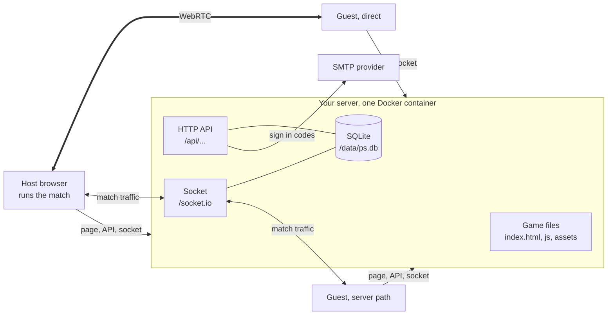

# Architecture

## One server



Everything is on one origin (for example `https://play.example.com`):

- the game files, served by Express from the built repo,
- the API under `/api/`,
- socket.io under `/socket.io/`.

One origin means the session cookie reaches the API and the socket by itself,
with no CORS. It also means one thing to deploy and one URL to share.

## What the server does

| Job | How |
| --- | --- |
| Serve the game | `express.static` on the build output. `version.json` and HTML are never cached, so `updater.js` keeps working. |
| Accounts | Email codes, guest accounts, cookie sessions ([04-auth.md](04-auth.md)). |
| Saves | One JSON document per player with a revision number. The client merges on conflict, as today. |
| Friends, profiles, invites | Tables in SQLite; invites and online status over the socket. |
| Rankings | Server-timed runs, the same boards as today, moderation. |
| Co-op setup | Rooms, codes, WebRTC offers and answers, over the socket. |
| Co-op server path | Forwards match messages for guests that can't reach the host directly. Never reads them. |

## Co-op paths

Unchanged from the PRs:

- **Direct (tried first):** the existing WebRTC data channel. STUN from
  `STUN_URLS` (default Google's free STUN; set it empty to skip STUN).
- **Server path:** match messages go over the host's and the guest's sockets
  when the direct channel doesn't open within 6 s (10 s on the same network).
- **Room modes:** "Direct first" (default) or "Always through server".
- **"Hide my IP in co-op":** a guest setting that forces the server path.
- **Same Wi-Fi:** the server sees both players share a public IP and tells the
  host (`sameNet`, never the IP). "Connect locally" adds the host's LAN address
  to the WebRTC setup (`lanCandidate`).

The star layout stays: guests only talk to the host. The server enforces it.

## What stays, what goes

| Stays | Goes |
| --- | --- |
| Gameplay, `coop.js`, `codec.js` | Firebase Authentication, Firestore, Realtime Database |
| `G.DB` API and the save format, `G.DB.merge` | `js/core/firebase-config.js`, `firebase.json`, rules, indexes, emulators |
| Local copy of the save for offline play | Google sign-in, name + password accounts |
| WebRTC direct path, `lanCandidate`, "Connect locally" | TURN, `ice.pokesurvivor.com` (TURN credentials and ranking seals) |
| `updater.js`, `version.json` | The RTDB signaling queue, join by IP, the Same Wi-Fi tab |
| Ranking boards and their ids | `CNAME`, hard-coded `pokesurvivor.com` links |
| Moderation screen | The hard-coded admin uid |

## Code map

Server (`server/`, grown from PR 5's `relay/`):

```
server/
  package.json
  index.js            starts http + Express + socket.io, reads config
  config.js           env vars with defaults
  db/
    index.js          opens SQLite (WAL), runs migrations
    migrations/001-init.sql
  http/
    static.js         game files and cache headers
    auth.js           /api/auth, /api/me
    save.js           /api/save
    social.js         /api/me/name, /api/profile, /api/friends
    rank.js           /api/runs, /api/boards, /api/reports
    admin.js          /api/admin
    guard.js          session lookup, X-PS header, Origin check, body limits
  relay/
    io.js             socket wiring (from PR 5 server.js)
    rooms.js          from PR 5
    limits.js         from PR 5
    words.js          from PR 5
  mail.js             nodemailer, or console in development
  test/
  Dockerfile        built from the repo root
fly.toml              (repo root, step 9)
```

Client:

| File | Change |
| --- | --- |
| `js/net/api.js` (new) | `G.Api`: `fetch` wrapper with the `X-PS` header, JSON, error codes. |
| `js/core/db.js` | Cloud mode now talks to `G.Api`. Local mode stays for `file://`. |
| `js/ui/login.js` | Email, then code, or "Play as guest". |
| `js/net/relay.js` | From PR 1, without the token and the `?relay` flag. |
| `js/net/net.js` | From PR 6, socket only. |
| `js/net/social.js` | From PR 3 plus REST for friends and profiles, socket for invites. |
| `js/net/ranking.js` | REST instead of Firestore, no seals. |
| `js/ui/mod-ui.js` | REST admin calls. |
| `js/net/room-code.js`, `js/data/room-words.js` | From PR 2, unchanged. |
| `js/ui/social-ui.js` | From PR 4, without the flag checks. |
| `sw.js` | Skips `/api/` and `/socket.io/`. |

## Local development

```bash
cd server && npm install && MAIL=console npm run dev
```

`npm run dev` serves the repo root (so `dev.html` works without building) on
`http://localhost:8787`, with SQLite in `server/.data/`. Sign in codes appear
in the terminal. For the Windows PC, forward port 8787 only. No emulators.
