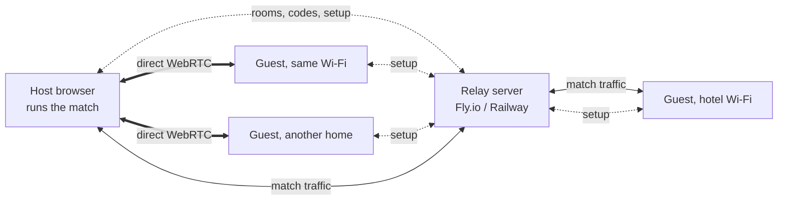

# Architecture

## Two paths from a guest to the host

- **Setup (always through the server):** room create and join, membership,
  WebRTC offers, answers and ICE candidates.
- **Direct path:** the existing WebRTC data channel. Tried first for every guest.
- **Server path:** match messages go over the guest's and the host's sockets.
  Used when the direct channel doesn't open within 6 s (10 s when both are on
  the same network).

The star layout stays: guests only talk to the host, and the host forwards what
others need. The server enforces it.

## Host choice per room

| Mode | Behavior |
| --- | --- |
| Direct first (default) | WebRTC first, server path as fallback for each guest. |
| Always through server | No WebRTC. Players' IPs are never shared with each other. |

Guests also get a setting, "Hide my IP in co-op", that forces the server path
for them.

## Same Wi-Fi

The server sees each socket's public IP. When a guest and the host share one,
it tells both `sameNet: true` (never the IP itself).

1. The direct wait goes up to 10 s.
2. If direct still fails (the browser hides local IPs with mDNS), the guest
   plays through the server right away.
3. The host's lobby offers "Connect locally" with the host's local IP. That's
   the `setLocal` / `lanCandidate` feature from the `coop-misma-wifi` branch.
   After it, guests on that Wi-Fi reconnect direct.

A browser can't host a LAN server like a console: pages can't listen for
connections, and an https page can't open an unencrypted `ws://192.168.x.x`
socket. WebRTC is the only browser-to-browser path.

## What stays, what goes

| Piece | Today | After |
| --- | --- | --- |
| Direct connection | WebRTC + Google STUN | Same, tried first |
| When direct fails | TURN pilot for a few accounts, else "network blocked" error and a 15 s retry loop | Server path, automatic |
| Signaling | Realtime Database `rooms/{uid}/q` | Socket `sig` events |
| Rooms | Realtime Database `rooms/{uid}` | Server memory |
| Room id | Host's Firebase uid | Four-Pokémon code |
| Joining | Friend invite, or IP on the same Wi-Fi | Friend invite (carries the code), or type the code |
| Match messages | `coop.js` + `NetCodec`, 15 per second | Unchanged on both paths |
| Saves, friends, rankings | Firestore | Unchanged |
| Realtime Database | Rooms and signaling (100 connection cap on the free plan) | Unused |

## Code map

| File | Role after the change |
| --- | --- |
| `relay/` | New. The server, its tests and deploy files. |
| `js/net/relay-config.js` | New. `G.RELAY_URL`. |
| `js/net/relay.js` | New. The socket: connect, auth, reconnect, events. Used by `net.js` and `social.js`. |
| `js/data/room-words.js` | New. Pokédex numbers allowed in room codes (shared with `relay/`). |
| `js/vendor/socket.io.min.js` | New. Pinned socket.io client, bundled by `tools/build.js`. |
| `js/net/net.js` | Same API. Signaling and the server path go through `G.Relay`. |
| `js/net/social.js` | Same API. Rooms go through `G.Relay`. Friends and invites stay in Firestore. |
| `js/net/coop.js` | No protocol change. |
| `js/ui/social-ui.js` | Create/join with code, mode choice, path badges. |

## Fork constraint

The Firebase key only accepts sign-ins from approved sites (that's the 403 on
localhost). A copy of the game on the fork's own domain can't sign in to
`pokesurvivor-free`. Options for real players:

- the owner merges this and points `G.RELAY_URL` at a server,
- the fork uses its own Firebase project (separate accounts and rankings).

For development, the Firebase emulator setup works as it does now.
